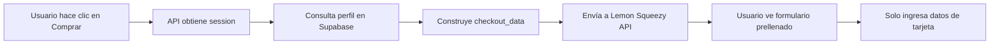

# Sistema de Prellenado de Datos en Checkout

## 📋 Descripción

El sistema obtiene automáticamente los datos del usuario autenticado y los envía a Lemon Squeezy para prellenar el formulario de checkout. Esto reduce la fricción en el proceso de compra y mejora la experiencia del usuario.

## 🎯 Datos Prellenados

### 1. **Email** (`checkout_data.email`)
- **Fuente**: `locals.session.user.email`
- **Campo en Lemon Squeezy**: Email del cliente
- **Beneficio**: Usuario no tiene que escribir su email

### 2. **Nombre Completo** (`checkout_data.name`)
- **Fuente**: `profile.first_name + profile.last_name`
- **Campo en Lemon Squeezy**: Nombre del titular
- **Formato**: "Juan Pérez"
- **Beneficio**: Nombre completo prellenado en tarjeta

### 3. **Número de Documento** (`checkout_data.tax_number`)
- **Fuente**: `profile.document_number`
- **Campo en Lemon Squeezy**: Tax Number (ID Fiscal - opcional)
- **Beneficio**: Documento de identidad prellenado para facturación

### 4. **Dirección de Facturación** (`checkout_data.billing_address`)
- **País**: `profile.country` (por defecto: 'EC' - Ecuador)
- **Ciudad**: `profile.city` (si está disponible)
- **Beneficio**: Datos de facturación prellenados

## 🔄 Flujo de Datos



## 💻 Implementación Técnica

### Frontend - Envío de Datos (`src/routes/evento/[id]/+page.svelte`):
```typescript
const response = await fetch('/api/create-checkout', {
  method: 'POST',
  headers: {
    'Content-Type': 'application/json'
  },
  body: JSON.stringify({
    eventId: event.id,
    eventTitle: event.title,
    tickets: selectedTickets,
    totalAmount: totalAmount,
    ticketDetails: ticketDetails
  })
});
```

### Backend - Obtención de Datos del Usuario:
```typescript
// Obtener perfil del usuario si está autenticado
let userProfile = null;
if (buyerId) {
  const { data: profile } = await supabaseAdmin
    .from('profiles')
    .select('first_name, last_name, document_number, city, country')
    .eq('id', buyerId)
    .single();
  
  userProfile = profile;
}
```

### Datos Obtenidos de Supabase:
```typescript
const { data: profile } = await supabaseAdmin
    .from('profiles')
    .select('first_name, last_name, document_number, city, country')
    .eq('id', buyerId)
    .single();
```

### Configuración del Producto:
```typescript
product_options: {
  name: `🎫 ${eventTitle}`,
  description: ticketDetails,
  receipt_button_text: 'Ver mis entradas',
  receipt_link_url: `${appUrl}/cuenta`,
  receipt_thank_you_note: '¡Gracias por tu compra! Tus entradas han sido enviadas a tu correo.'
}
```

### Estructura Completa Enviada a Lemon Squeezy:
```typescript
// Datos de checkout
const checkoutData = {
    email: "usuario@example.com",
    name: "Juan Pérez García",
    tax_number: "1234567890",
    billing_address: {
        country: "EC",
        city: "Quito"
    },
    custom: {
        event_id: "...",
        tickets: "...",
        buyer_id: "..."
    }
};

// Opciones del producto
const productOptions = {
    name: "🎫 Nombre del Evento",
    description: "2x Entrada General ($10.00)",
    receipt_button_text: "Ver mis entradas",
    receipt_link_url: "https://tu-app.com/cuenta",
    receipt_thank_you_note: "¡Gracias por tu compra! Tus entradas han sido enviadas a tu correo."
};
```

## Beneficios

1. **Mejor Experiencia de Usuario**: Menos datos que ingresar manualmente
2. **Proceso Más Rápido**: Solo necesita ingresar datos de pago
3. **Menos Errores**: Datos ya validados en el perfil
4. **Confirmación Visual**: País correcto (Ecuador) por defecto

## 🔒 Validaciones

- Si el usuario **NO está autenticado**: Solo se prellenan valores por defecto (país: EC)
- Si el usuario **NO tiene perfil completo**: Solo se usa el email
- Si el usuario **tiene perfil completo**: Todos los datos se prellenan

## 🧪 Pruebas

### Para probar el prellenado completo:

1. Inicia sesión con una cuenta que tenga perfil completo
2. Ve a un evento y haz clic en "Comprar"
3. En el checkout de Lemon Squeezy deberías ver:
   - ✅ **Nombre del evento** con emoji 🎫
   - ✅ **Detalles de entradas** (cantidad y precio)
   - ✅ Email prellenado
   - ✅ Nombre del titular prellenado
   - ✅ Tax Number (ID Fiscal) prellenado
   - ✅ País y ciudad prellenados
   - ❌ Datos de tarjeta vacíos (el usuario debe ingresarlos)

### Tarjetas de prueba:
- **Éxito**: `4242 4242 4242 4242`
- **Fallo**: `4000 0000 0000 0002`

## 📝 Notas

- El campo `tax_number` es **opcional** en Lemon Squeezy
- El prellenado funciona en ambos modos: `test_mode: true/false`
- Los datos prellenados pueden ser editados por el usuario si lo desea
- No se almacenan datos de tarjetas en nuestra base de datos (solo en Lemon Squeezy)

## 🌍 Variables de Entorno Requeridas

```bash
# Lemon Squeezy
LEMON_SQUEEZY_API_KEY=tu_api_key
LEMON_SQUEEZY_STORE_ID=tu_store_id
LEMON_SQUEEZY_VARIANT_ID=tu_variant_id

# App URL
PUBLIC_APP_URL=https://tu-dominio.com
```
